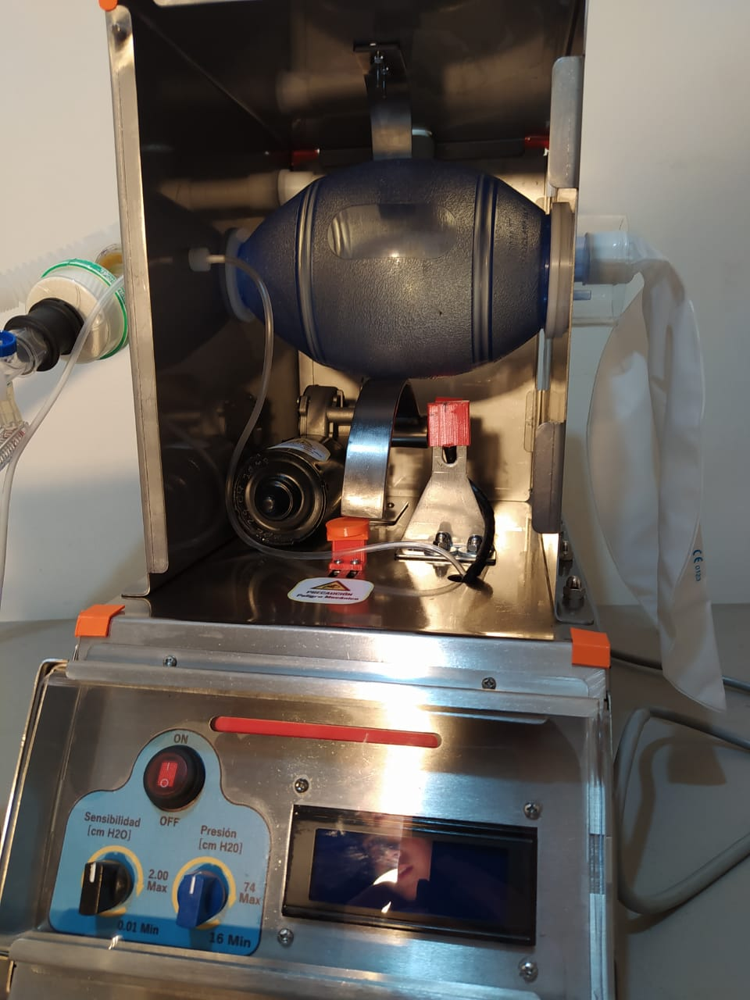
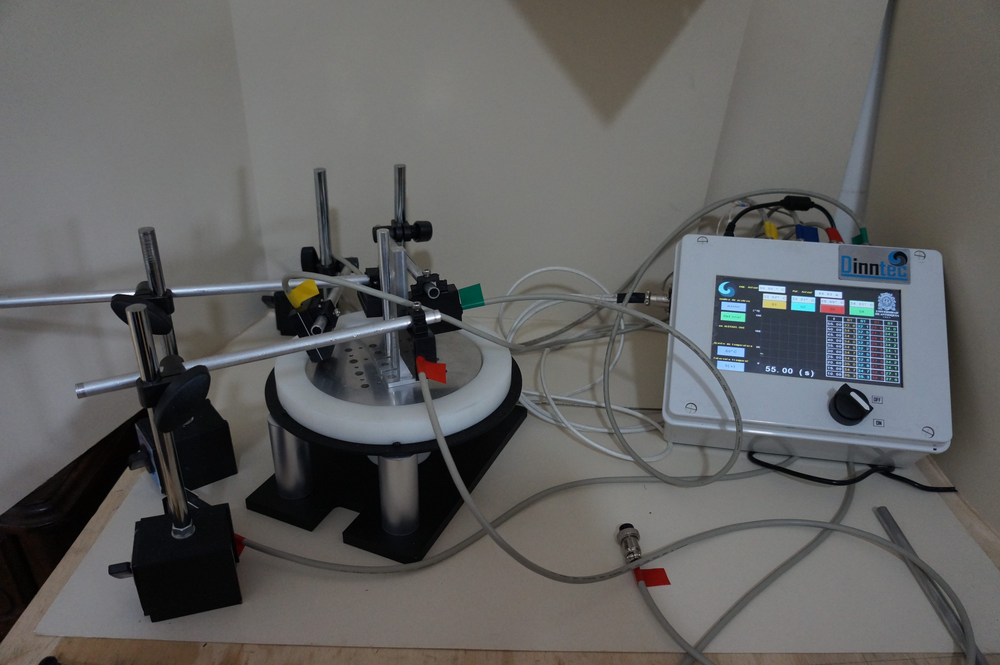
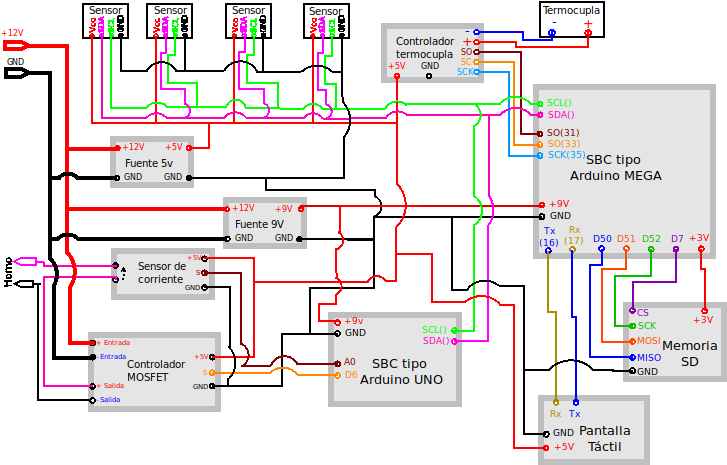

<h1 align="center">Hi, I'm Maribel Andrea Gutiérrez 👋</h1>

<h3 align="center">
Senior Frontend Engineer · Angular · React · TypeScript
</h3>

  Building scalable, maintainable, and user-focused web applications.

  <a href="#-about-me">About</a> ·
  <a href="#-experience">Experience</a> ·
  <a href="#-technical-expertise">Expertise</a> ·
  <a href="#-currently-exploring">Currently Exploring</a> ·
  <a href="#-lets-connect">Contact</a>

---

# 👩‍💻 About Me

I'm a **Senior Frontend Engineer with 6+ years of professional experience** building and maintaining web applications.

My strongest background is in **Angular and TypeScript**, working with enterprise applications, complex frontend architectures, state management, reusable UI components, and scalable development workflows.

Throughout my career, I've focused on turning complex business requirements into applications that are:

- Maintainable
- Scalable
- Performant
- User-friendly

I also work with **React and Next.js** and enjoy continuously expanding my knowledge of modern frontend technologies.

📍 Based in Colombia  
🌎 Open to remote and international opportunities

---

# 💼 Experience

Over the past **6+ years**, I've worked on professional software products and applications where I have contributed to frontend development, application architecture, UI implementation, and engineering improvements.

Much of my professional work is not publicly available due to **confidentiality and intellectual property restrictions**.

However, my professional experience includes:

### 🅰️ Angular Development

- Building and maintaining enterprise web applications
- Developing reusable components
- Working with complex application workflows
- Integrating frontend applications with APIs
- Managing application state

### 🧩 Frontend Architecture

- Nx monorepos
- Shared libraries
- Modular applications
- Reusable component systems
- Microfrontend architecture

### 🔄 State Management

- RxJS
- NgRx
- Angular Signals

### 🎨 User Interfaces

- Responsive interfaces
- Component libraries
- Angular Material
- PrimeNG
- Modern UI implementation

---

# 📈 Career Highlights

## 🚀 6+ Years of Professional Experience

Building and maintaining frontend applications using modern web technologies.

## 📈 Performance

Contributed to improvements resulting in **30%+ application performance gains**.

## ⚡ Engineering Efficiency

Helped improve engineering workflows and contributed to a **50% reduction in deployment time**.

## 🏢 Enterprise Applications

Experience working with complex applications, large codebases, and scalable frontend architectures.

## 👩‍💻 Frontend Ownership

Experience taking responsibility for frontend development and contributing throughout the implementation and delivery process.

---

# 🏗️ Engineering Projects & Professional Work

A selection of engineering and software development projects from different stages of my professional journey.

These projects reflect my experience working across electronic engineering, hardware design, mobile application
development, software engineering, and connected systems.

Some of these projects were developed earlier in my career. Although the available documentation and screenshots are
limited, they represent valuable hands-on experience in designing and developing real-world engineering solutions.

---

## 01. Eira — Medical Device Development

**Electronic Engineering · Hardware Design · Flutter · Mobile Development · Backend Integration**

Eira was a medical-device project developed during the COVID-19 period, combining electronic hardware design and
software development into an integrated engineering solution.

The project involved developing the electronic hardware and building a mobile application to support the software side
of the solution, alongside backend functionality for data storage.

### My Role & Contributions

I contributed to the development of the solution across hardware and software:

- **Electronic Hardware Design:** Worked on the design and development of the device's electronic hardware.
- **Mobile Application Development:** Developed the mobile application using Flutter.
- **Backend Development:** Contributed to backend functionality responsible for data storage.
- **System Integration:** Worked across the hardware and software components of the solution.

### Technology & Engineering Areas

`Flutter` · `Dart` · `Electronic Hardware Design` · `Mobile Development` · `Backend Integration` · `Data Storage`

### Project Gallery

  

<b>More about this project</b>

This project represents an important stage of my engineering career, where I worked beyond traditional software
development and gained experience connecting electronic hardware with mobile and backend software components.

It strengthened my understanding of how different engineering disciplines come together to create an integrated
technical solution.

---

## 02. Heat Equipment Monitoring System

**Electronic Engineering · IoT · Application Development · Hardware/Software Integration

An engineering and software development project focused on studying heat transfer and monitoring measurements from
heating equipment.

The solution involved the integration of hardware and software components to collect and visualize equipment
measurements through an application developed from scratch.

### My Role & Contributions

I was responsible for developing the application from scratch and contributing to the integration of the hardware and
software components.

My contributions included:

- **Application Development: Designed and developed the application from the ground up.
- **User Interface: Implemented the interface for monitoring equipment measurements.
- **Monitoring Functionality: Worked on the application's monitoring capabilities.
- **Hardware/Software Integration: Contributed to connecting the software solution with the physical equipment.
- **Engineering Implementation: Worked across the application and the broader monitoring system.

### Technology & Engineering Areas

`IoT` · `Electronic Engineering` · `Application Development` · `Hardware Integration` · `Real-Time Monitoring` ·
`Data Visualization`

Project Gallery

  
  

<b>More about this project</b>

This project allowed me to combine my background in electronic engineering with software development.

One of its most valuable aspects was taking responsibility for the application development from scratch while
considering the relationship between physical equipment, collected measurements, and the software used to monitor them.

It represents my experience working with systems where software interacts with physical equipment, translating
engineering requirements into functional monitoring applications.

---

## A Note on Historical Projects

These projects are presented as selected examples of my previous engineering and software development experience.

The images and documentation reflect the materials available from their original development periods. They are included to demonstrate my technical background and contributions, rather than represent recently developed products.

---

# 🛠️ Technical Expertise

## Frontend

## Architecture & State Management

**RxJS · NgRx · Angular Signals · Nx · Monorepos · Microfrontends**

## UI & Styling

**Angular Material · PrimeNG · Tailwind CSS · Responsive Design · Design Systems**

## Backend & Integration

**REST APIs · FastAPI · PostgreSQL · Authentication**

## Engineering

**Git · GitHub · CI/CD · Agile Development**

---

# 🔭 Currently Exploring

I'm interested in continuing to deepen my knowledge and experience in:

- React and Next.js
- Modern frontend architecture
- AI-powered applications
- Computer vision
- IoT and connected systems

---

# 🎓 Background

🎓 **Electronic Engineer**

My engineering background gives me a broader perspective when working with technology, systems, and software products.

---

# 🤝 Let's Connect

I'm always interested in connecting with developers, engineers, recruiters, and teams building interesting products.

💼 **LinkedIn:** [Connect with me](https://www.linkedin.com/in/maribel-gutierrez/)

📧 **Email:** maribell426@hotmail.com

🌎 **Colombia · Open to Remote & International Opportunities**

---

  <i>Building scalable, maintainable, and user-focused web experiences.</i>

